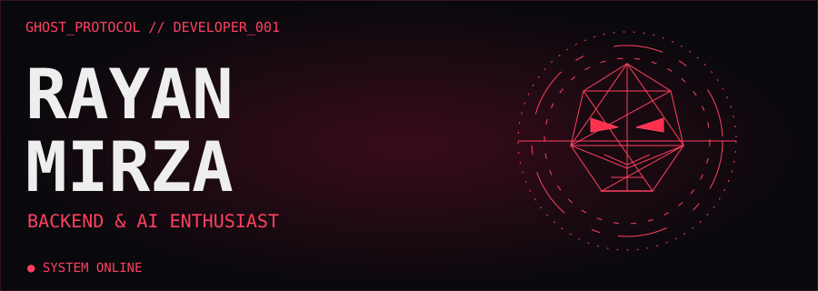
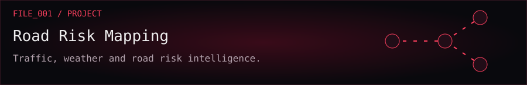
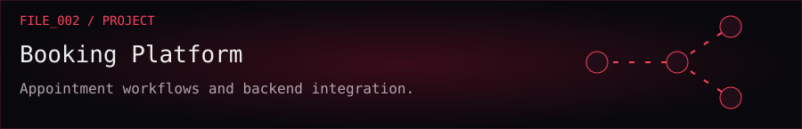
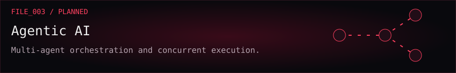

## 01 / IDENTITY — Behind the code.

## 02 / TECHNOLOGY — The engineering arsenal.

**Languages:** JavaScript · TypeScript · SQL · Java · Python

**Backend & Data:** Node.js · PostgreSQL · Supabase

**Developer Tools:** Git · GitHub · VS Code

## 03 / PROJECTS — Engineering in action.

## 04 / ANALYTICS — Digital footprint.

[GitHub activity](https://github.com/RayanMirza)

## 05 / CONTRIBUTIONS — Every commit counts.

## 06 / CONNECTIONS — Let's build something.

[GitHub](https://github.com/RayanMirza)

